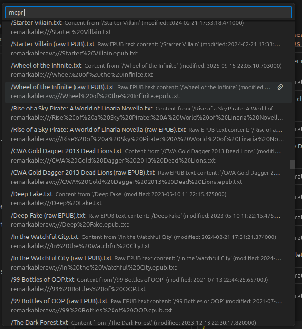
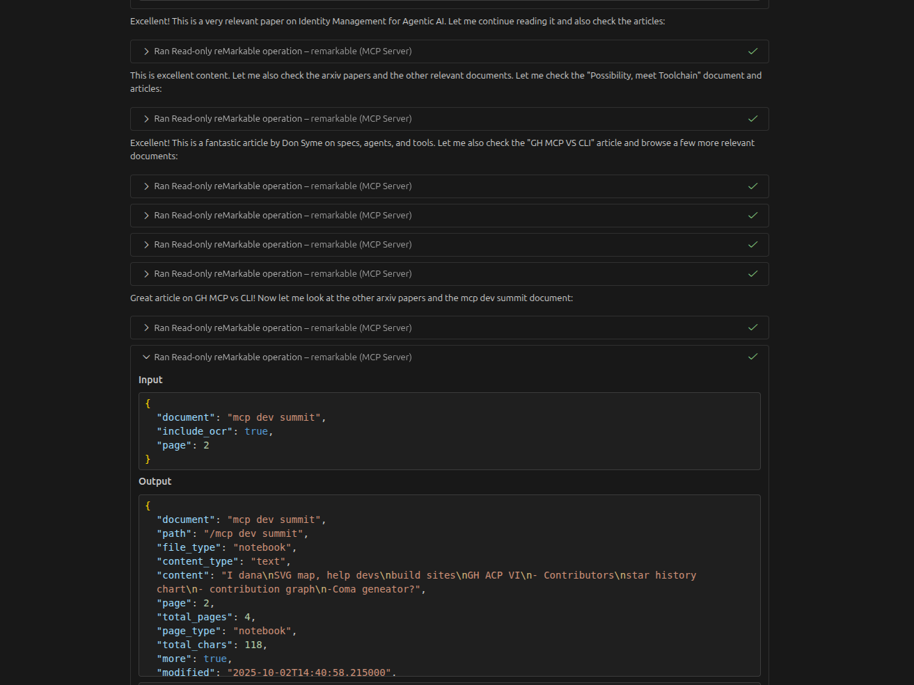

# reMarkable MCP Server

Unlock the full potential of your reMarkable tablet as a **second brain** for AI assistants. This MCP server lets Claude, VS Code Copilot, and other AI tools read, search, and traverse your entire reMarkable library — including handwritten notes, which the assistant reads from page images and can save as searchable transcripts.

<!-- mcp-name: io.github.wavyrai/rm-mcp -->

## Why rm-mcp?

Your reMarkable tablet is a powerful tool for thinking, note-taking, and research. But that knowledge stays trapped on the device. This MCP server changes that:

- **Full library access** — Browse folders, search documents, read any file
- **Typed text extraction** — Native support for Type Folio and typed annotations
- **Handwriting** — The assistant reads page images and saves transcripts, which then become searchable
- **PDF & EPUB support** — Extract text from documents, plus your annotations
- **Smart search** — Find content across your entire library
- **Organise your library** — Rename, move, and create folders (nothing is ever deleted)
- **Second brain integration** — Use with Obsidian, note-taking apps, or any AI workflow

Whether you're researching, writing, or developing ideas, rm-mcp lets you leverage everything on your reMarkable through AI.

---

## Quick Install

Uses the reMarkable Cloud API. Requires a reMarkable Connect subscription.

### One-command setup (recommended)

```bash
uvx rm-mcp --setup
```

This opens your browser, prompts for the one-time code, and prints the ready-to-paste config for Claude Code and Claude Desktop.

### Manual setup

#### 1. Get a One-Time Code

Go to [my.remarkable.com/device/browser/connect](https://my.remarkable.com/device/apps/connect) and generate a code.

#### 2. Convert to Token

```bash
uvx rm-mcp --register YOUR_CODE
```

#### 3. Add to your MCP client

**Claude Code:**

```bash
claude mcp add remarkable \
  -e REMARKABLE_TOKEN='<paste token from step 2>' \
  -- uvx rm-mcp@latest
```

**Claude Desktop** — add to `claude_desktop_config.json` (use full path to `uvx`, e.g. from `which uvx`):

```json
{
  "mcpServers": {
    "remarkable": {
      "command": "/Users/YOU/.local/bin/uvx",
      "args": ["rm-mcp@latest"],
      "env": {
        "REMARKABLE_TOKEN": "<paste token from step 2>"
      }
    }
  }
}
```

---

<!-- Screenshots section - uncomment when screenshots are added
## Screenshots

### MCP Resources

Documents appear as resources that AI assistants can access directly:



### Tool Calls in Action

AI assistants use the tools to read documents, search content, and more:


-->

---

## Tools

| Tool | Description |
|------|-------------|
| `remarkable_find` | Search names, typed text, PDF/EPUB text, highlights and saved transcripts; no query lists recent documents |
| `remarkable_list` | The folder tree with ids, types, page counts and dates (paged) |
| `remarkable_read` | Text per tablet page; marks handwritten pages that have no transcript yet |
| `remarkable_view` | Page images (PNG, opaque paper background), up to 4 pages per call |
| `remarkable_annotations` | Highlights and the pages that carry handwriting |
| `remarkable_save_transcript` | Store the assistant's transcript of a handwritten page (local index only) |
| `remarkable_status` | Connection, index and settings |
| `remarkable_rename` / `remarkable_move` / `remarkable_create_folder` | Organise the library (never deletes) |

Documents are addressed by a stable **id**: every result carries it, and paths
or names are accepted wherever an id is. Page numbers are tablet pages, so a
page inserted into a PDF counts. Every tool except `remarkable_view` returns
structured output with an `outputSchema`.

`remarkable_search`, `remarkable_browse`, `remarkable_recent` and
`remarkable_image` still answer for one release as deprecated aliases.

📖 **[Full Tools Documentation](docs/tools.md)**

### Example Usage

```python
# What did I work on recently?
remarkable_find()

# Find a topic across names, text, highlights and transcripts
remarkable_find(query="quarterly budget", type="notebook")

# Browse a folder, two levels deep
remarkable_list(folder="/Work", depth=2)

# Read pages 1-5 (ids come from find/list; a path also works)
remarkable_read(id="/Work/Standup", pages="1-5")

# Look at a handwritten page, then keep what it says
remarkable_view(id="5f0c…", pages="2")
remarkable_save_transcript(id="5f0c…", page=2, text="Ship the fixtures by Friday")
```

---

## Resources

Resource templates resolve live against the current library:

| URI | Description |
|-----|-------------|
| `remarkable://doc/{id}` | The document's text, page by page, with saved transcripts |
| `remarkable://doc/{id}/page/{n}.png` | Tablet page n as a PNG |

📖 **[Full Resources Documentation](docs/resources.md)**

## Prompts

| Prompt | What it does |
|--------|--------------|
| `transcribe_notebook` | Turn a notebook into Markdown, saving each handwritten page's transcript |
| `weekly_review` | Summarise the past week's notes with action items |
| `find_topic` | Gather every note, highlight and page about a topic |

---

## Handwriting

rm-mcp does not run OCR. Your assistant already reads images: `remarkable_read`
marks handwritten pages, `remarkable_view` shows them, and
`remarkable_save_transcript` keeps what the assistant read. The transcript is
stored in the local index under the page's content hash, so search and read
include it until that page is edited on the tablet.

Earlier versions used MCP sampling for OCR. Sampling is deprecated and Claude
clients do not support it, so it was removed; transcripts it produced are still
read.

---

## Advanced Configuration

### Root Path Filtering

Limit the MCP server to a specific folder on your reMarkable. All operations will be scoped to this folder:

```json
{
  "servers": {
    "remarkable": {
      "command": "uvx",
      "args": ["rm-mcp"],
      "env": {
        "REMARKABLE_TOKEN": "your-token",
        "REMARKABLE_ROOT_PATH": "/Work"
      }
    }
  }
}
```

With this configuration:
- `remarkable_list()` shows the contents of `/Work`
- `remarkable_list(folder="/Projects")` shows `/Work/Projects`
- Documents outside `/Work` are not accessible

Useful for:
- Focusing on work documents during office hours
- Separating personal and professional notes
- Limiting scope for specific AI workflows

### Custom Background Color

Set the default background color for image rendering:

```json
{
  "servers": {
    "remarkable": {
      "command": "uvx",
      "args": ["rm-mcp"],
      "env": {
        "REMARKABLE_TOKEN": "your-token",
        "REMARKABLE_BACKGROUND_COLOR": "#FFFFFF"
      }
    }
  }
}
```

Supported formats:
- `#RRGGBB` — RGB hex (e.g., `#FFFFFF` for white)
- `#RRGGBBAA` — RGBA hex (e.g., `#00000000` for transparent)

Default is `#FBFBFB` (reMarkable paper color), opaque so ink stays visible in dark-mode clients. This affects `remarkable_view` and the page image resource.

### All Environment Variables

| Variable | Default | Description |
|----------|---------|-------------|
| `REMARKABLE_TOKEN` | *(required)* | Auth token from `uvx rm-mcp --setup` |
| `REMARKABLE_ROOT_PATH` | `/` | Limit access to a specific folder |
| `REMARKABLE_READ_ONLY` | *(off)* | Set to `1` to disable renaming, moving and creating folders |
| `REMARKABLE_BACKGROUND_COLOR` | `#FBFBFB` | Background color for rendered images (`#RRGGBB` or `#RRGGBBAA`) |
| `REMARKABLE_CACHE_TTL` | `60` | Collection cache TTL in seconds |
| `REMARKABLE_COMPACT` | *(off)* | Set to `1` or `true` to omit hints from the organising tools' responses |
| `REMARKABLE_MAX_OUTPUT_CHARS` | `50000` | Maximum characters of page text per `remarkable_read` call |
| `REMARKABLE_PARALLEL_WORKERS` | `5` | Parallel workers for metadata fetching |
| `REMARKABLE_INDEX_CONTENT` | `1` | Set to `0` to disable background indexing of page text |
| `REMARKABLE_INDEX_PATH` | `~/.cache/rm-mcp/index.db` | SQLite full-text search index location |
| `REMARKABLE_INDEX_REBUILD` | *(off)* | Set to `1` to clear the search index on startup (saved transcripts are kept) |

Most users only need `REMARKABLE_TOKEN`. The rest are for advanced tuning.

---

## Use Cases

### Research & Writing

Use rm-mcp while working in an Obsidian vault or similar to transfer knowledge from your handwritten notes into structured documents. AI can read your research notes and help develop your ideas.

### Daily Review

Ask your AI assistant to summarize your recent notes, find action items, or identify patterns across your journal entries.

### Document Search

Find that half-remembered note by searching across your entire library — including handwritten pages once they have a transcript.

### Knowledge Management

Treat your reMarkable as a second brain that AI can access. Combined with tools like Obsidian, you can build a powerful personal knowledge system.

---

## Documentation

| Guide | Description |
|-------|-------------|
| [Tools Reference](docs/tools.md) | Detailed tool documentation |
| [Resources Reference](docs/resources.md) | MCP resources documentation |
| [Development](docs/development.md) | Contributing and development setup |
| [Future Plans](docs/future-plans.md) | Roadmap and planned features |

---

## Development

```bash
git clone https://github.com/wavyrai/rm-mcp.git
cd rm-mcp
uv sync --all-extras
uv run pytest tests/test_server.py -v
```

📖 **[Development Guide](docs/development.md)**

---

## License

MIT

---

Built with [rmscene](https://github.com/ricklupton/rmscene), [PyMuPDF](https://pymupdf.readthedocs.io/), and inspiration from [ddvk/rmapi](https://github.com/ddvk/rmapi).
